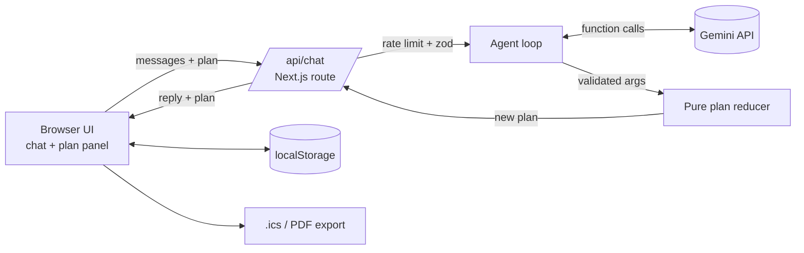

# Community Event Copilot

A GenAI planning assistant for weddings, birthdays and community events (college fests, society pujas, meetups). You chat in English or Hindi, and a Gemini agent keeps a live plan in sync: budget, timeline, vendor checklist, RSVPs and ideas.

**Live:** LIVE_URL

## Problem statement

> Create a GenAI-powered planning assistant that helps users organize weddings, birthdays, and community events with budgets, timelines, vendor checklists, and personalized ideas.

| Requirement | How it is covered |
|---|---|
| Weddings, birthdays, community events | `set_event` supports wedding, birthday, community, college_fest, society. Sample prompts cover all three. |
| Budgets | `set_budget` splits the total by category, `log_expense` records spends. Over-budget alerts show per category and overall. Bar chart in the side panel. |
| Timelines | `add_tasks` schedules tasks backwards from the event date (`daysBefore`). Tick tasks off, export to calendar (.ics). |
| Vendor checklists | `upsert_vendors` keeps todo / shortlisted / booked vendors with quotes. No made-up business names. |
| Personalized ideas | `add_ideas` stores themes, decor, food and activities based on city, guests, budget and culture. |
| Extra | RSVP tracker with confirmed headcount, Hindi replies, PDF export (print view), per-browser persistence. |

## How Gemini is used

The `/api/chat` route runs a small agent loop with the `@google/genai` SDK and function calling:

1. The client sends recent messages plus the current plan JSON.
2. Gemini answers with function calls (`set_event`, `set_budget`, `add_tasks`, ...).
3. Each call is validated with zod and applied by a pure reducer (`src/lib/plan.ts`). Errors go back to the model so it can fix its arguments.
4. Up to 6 rounds, then the final text reply and the new plan go back to the browser.

The model never writes state directly. It can only call typed tools, so the plan stays consistent and testable. A fallback model list (`GEMINI_MODELS`) handles rate limits and slow models.



## Security and quality

- API key only on the server (`GEMINI_API_KEY` env var), never sent to the browser or committed.
- zod validation on the request body and on every tool argument. Message length, history and plan size are capped.
- Per-IP sliding-window rate limit (12 requests per minute) and a request size limit.
- Security headers: CSP, HSTS, X-Frame-Options DENY, nosniff, Referrer-Policy, Permissions-Policy.
- No database, no auth, no PII stored on the server. The plan lives in your browser.
- Accessibility: labelled inputs, skip link, live region for chat, `role="alert"` for budget warnings, keyboard friendly controls, visible focus rings, AA contrast colors, chart bars with text labels.
- CI on GitHub Actions: lint, typecheck, tests, build.

## Run locally

```bash
npm install
echo "GEMINI_API_KEY=your_key" > .env.local
npm run dev     # http://localhost:3000
npm test        # vitest unit tests
```

Optional: `GEMINI_MODELS=gemini-3-flash-preview,gemini-3.1-flash-lite` to change the model order.

## Project layout

```
src/app/page.tsx          chat UI + live plan panel
src/app/api/chat/route.ts Gemini agent loop, validation, rate limit
src/lib/plan.ts           plan types, zod schemas, pure tool reducer, budget alerts
src/lib/tools.ts          function declarations + system prompt
src/lib/ics.ts            calendar export
src/lib/ratelimit.ts      sliding window limiter
tests/                    unit tests for tools, export, limiter, API validation
```

## License

MIT
